 

## 🧭 About Me

<table>
<tr>
<td>

I'm currently pursuing a **B.Tech in Cybersecurity**, working at the intersection of three domains I'm most drawn to:

- 🌐 **Web Development**
- 🔐 **Cybersecurity**
- ✨ **Artificial Intelligence**

My goal is simple: build technology that is **practical, intelligent, secure, and scalable**.

</td>
</tr>
</table>

## 🚀 Project-ELIZA · 30 Days · 30 AI Projects

**One day. One AI project.** Project-ELIZA is my 30-day challenge to build 30 practical AI projects, sharing the code, experiments, and lessons learned along the way.

 

---

## 💼 Experience

### 💻 Fullstack Developer — Gremio Technologies

I'm working as the solo developer on **LMS, EMS, and ERP** applications, handling both frontend and backend development. I've also worked on **AI integration in EMS**.

### 🐍 Python Developer — Yash Industries

Developed my skills in **Python**, learning and working with tools and frameworks including **Django, PyTorch, and PyWin**.

### 🚓 Cyber Police Internship
`[INTERNSHIP DURATION]` · `[LOCATION / DEPARTMENT]`

During my internship with the **Cyber Police**, I gained hands-on exposure to cybersecurity operations, cybercrime-related casework, and real-world technical problem solving — bridging the gap between classroom theory and applied security practice.

**Key contributions:**

- 🖼️ **Selfie-Based Attendance Marker** — Worked on a selfie-based attendance marking system as part of internal process improvement, applying practical technical problem-solving to a real operational need.
- 💰 **Financial Recovery Assistance** — Assisted in a case that led to the successful recovery of approximately **₹56,000** for an affected individual.
- 🛡️ **Operation Thunder** — Participated as an active member in Operation Thunder, an anti-drug operation.
